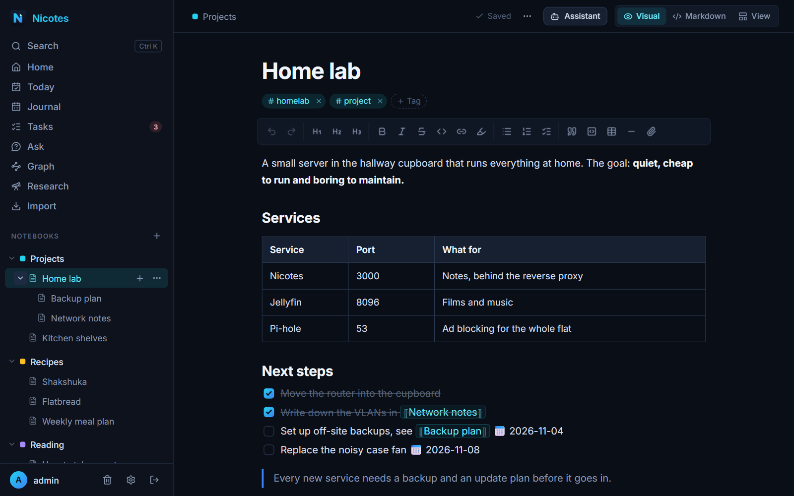
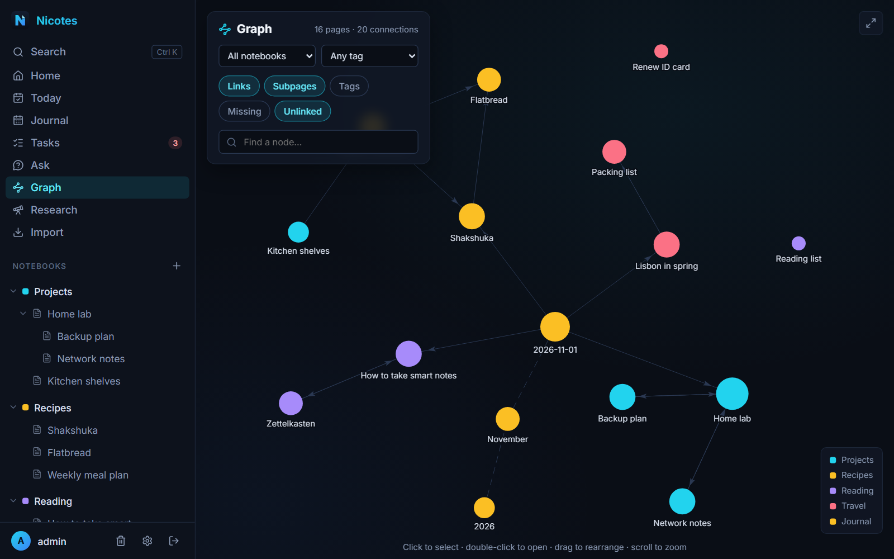
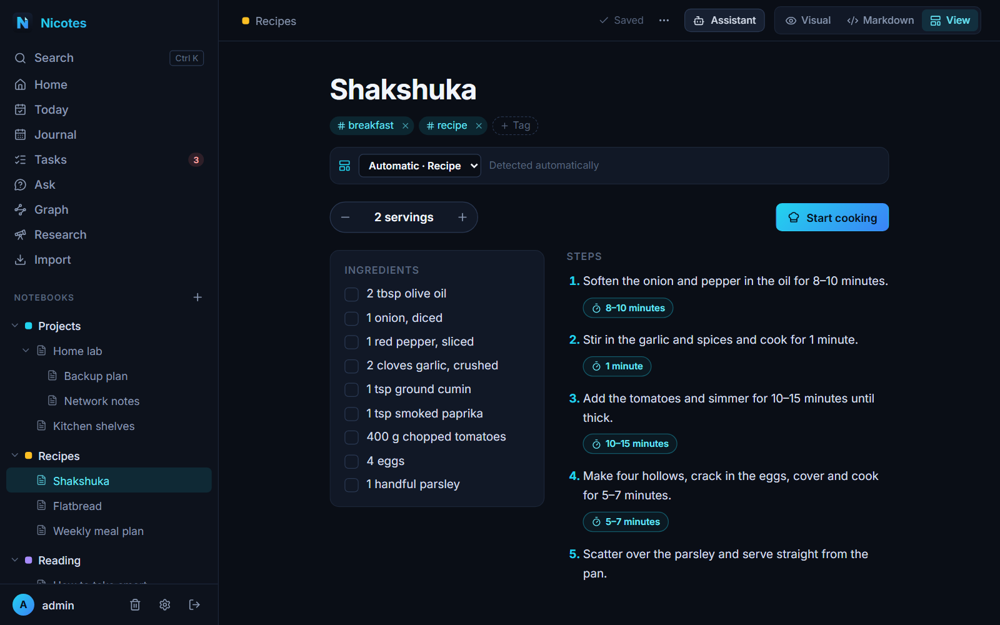
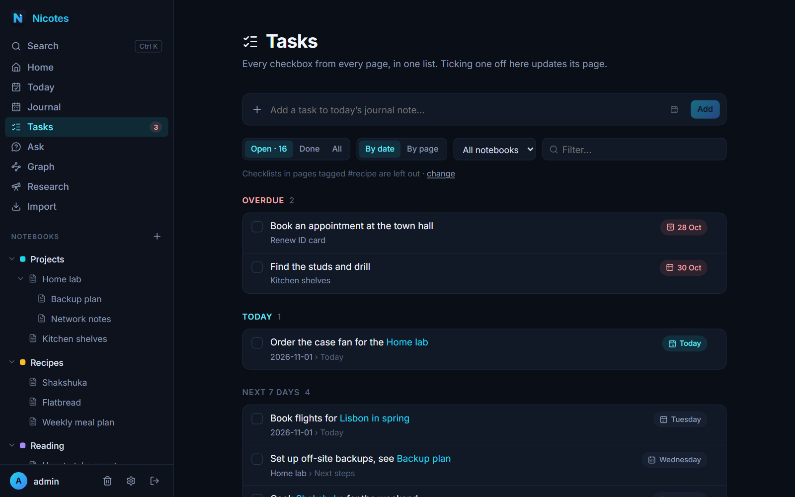
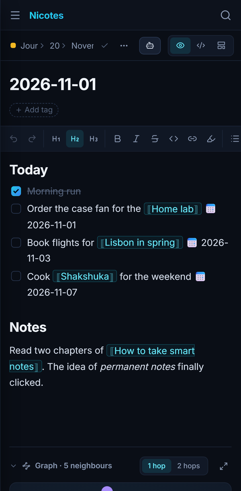
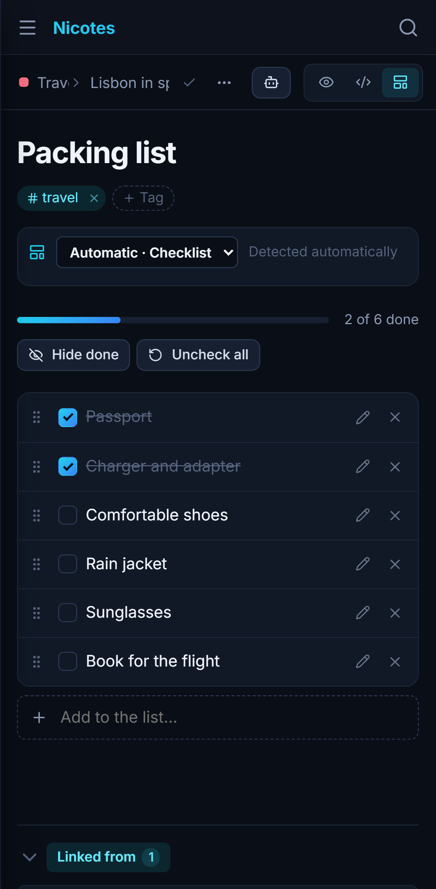
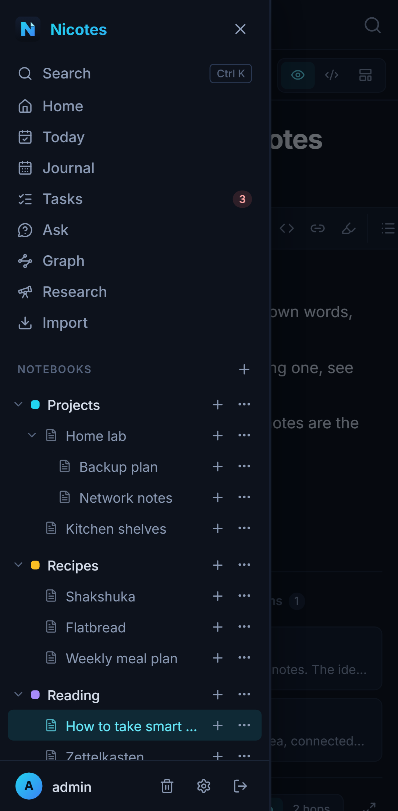

<div align="center">


**Self-hosted notes that are easy to group and link, somewhere between OneNote and Obsidian.**

[](https://git.nico.software/1n9i9c7om/nicotes/-/pipelines)
[](https://git.nico.software/1n9i9c7om/nicotes/-/releases)
[](#quick-start)
[](#development)
[](#development)
[](#phone-app)
[](LICENSE)

[Quick start](#quick-start) · [Features](#features) · [Changelog](CHANGELOG.md) · [Design & roadmap](docs/DESIGN.md)



</div>

## Why Nicotes?

OneNote gives you notebooks and pages but few connections between them. Obsidian gives
you links and a graph, but a folder of files can be a lot to keep in order. Nicotes tries to
sit in between: a calm web app where notes live in **notebooks and nested pages**, and
**links, tags and a graph** connect them across notebooks, without having to plan any of
it upfront.

- 🗂️ **Notebooks and subpages** you can drag around, with colours, tags and a full-text search (<kbd>Ctrl</kbd> <kbd>K</kbd>).
- 🔗 **`[[Links]]`, backlinks and a graph**, plus unlinked mentions that turn into links with one click.
- ✅ **Every checkbox in one task list**, grouped by due date, with a daily journal note.
- 🍳 **Pages that know what they are**: recipes with servings and timers, checklists, step-by-step guides, a read-aloud reader.
- 🤖 **Optional AI** through OpenRouter or Routeway: ask your notes, research the web, an assistant whose changes you review like a diff.
- 📱 **On every screen**: installable on your phone, and in the sidebar of Firefox, Chrome and Edge.
- 💾 **Your data, on your server**: one container, daily backups and a Markdown export that opens in Obsidian.

<table>
  <tr>
    <td width="50%"><br><sub><b>Graph</b>: how pages connect through links, subpages and tags.</sub></td>
    <td width="50%"><br><sub><b>View</b>: a recipe with adjustable servings, timers and a cook mode.</sub></td>
  </tr>
  <tr>
    <td width="50%"><br><sub><b>Tasks</b>: every checkbox from every page, grouped by due date.</sub></td>
    <td width="50%">
      
      
      
      <br><sub><b>Phone</b>: the same app, laid out for small screens.</sub>
    </td>
  </tr>
</table>

## Quick start

All you need is Docker with Compose. In an empty folder, e.g. `/opt/nicotes`:

```bash
curl -fsSLO https://git.nico.software/1n9i9c7om/nicotes/-/raw/main/docker-compose.yml
curl -fsSL https://git.nico.software/1n9i9c7om/nicotes/-/raw/main/.env.example -o .env
nano .env              # choose NICOTES_ADMIN_USER and your own NICOTES_ADMIN_PASSWORD
docker compose up -d
```

Open http://localhost:3000 and sign in. Nicotes refuses to start with the example
password, so pick your own. Data lives in the `nicotes-data` volume (SQLite database,
attachments and the key that encrypts stored API keys); see [Backups](#backups).

**Updating:** `docker compose pull && docker compose up -d`. The image comes from the
project's container registry (`registry.nico.software/1n9i9c7om/nicotes`):

| Tag | What it is |
|---|---|
| `main-latest` | the newest release (default) |
| `v0.4.0` | one particular release; set `NICOTES_TAG=v0.4.0` in `.env` to stay on it |
| `dev-latest` | the current `develop` build, for testing only |

**Over the internet,** put Nicotes behind a reverse proxy that serves HTTPS (Caddy,
Traefik, nginx …), publish the port on localhost only (`127.0.0.1:3000:3000` in
`docker-compose.yml`) and set `NICOTES_SECURE_COOKIES=true` in `.env`. HTTPS is also what
lets you install it on your phone.

**From source:** clone the repository and run `docker compose up -d --build` in it, which
builds the image from your checkout instead of pulling it.

## Features

### Writing

Pages are Markdown, edited either formatted (**Visual**) or as source (**Markdown**). The
toolbar's highlighter button colours the selected text or its background from a small
palette; colours are stored the way Obsidian writes them (`==highlight==`,
`<mark style="background: green">`, `<span style="color: red">`), so they survive an export.

### Graph, journal and templates

The **Graph** shows how pages connect through `[[links]]`, subpages and tags, filterable
by notebook or tag, with a focus mode around any page; every page also has a small local
graph. **Today** opens the daily note (filed as Journal › year › month, see **Journal** for
the calendar). Any page tagged `#template` can be used for new pages and daily notes, with
`{{date}}`, `{{time}}`, `{{weekday}}` and `{{title}}` placeholders.

### Tasks and connections

Every `- [ ]` checkbox in any page shows up under **Tasks**, grouped by due date
(`📅 2026-10-25` in the text, or pick a date in the list); ticking one off there updates its
page, and new tasks go into today's journal note. Checklists of pages tagged `#recipe` stay
out (Settings → Tasks). Below each page, **Connections** shows backlinks, **unlinked
mentions** (pages that name each other without a link, linked with one click) and, with
the semantic index, **related** pages.

### Interactive views

Next to Visual and Markdown, **View** shows a page the way its content wants to be used: a
checklist to tick and drag around, a recipe with adjustable servings, timers (for a range
like "20–30 minutes" you pick the time, starting in the middle) and a full-screen cook mode, a step-by-step guide, or a reader that reads stories aloud and
highlights the current sentence. The layout is detected automatically; with an OpenRouter
key the AI decides for unclear pages (a fraction of a cent each), and you can always pick one
yourself. Changes made in a view (ticking, adding, reordering) edit the page itself.

In every mode, drag either edge of the page to make it wider or narrower (double-click the
edge to reset); the width is remembered per browser.

### Ask your notes (optional)

With an OpenRouter key, **Ask** answers questions from your own notes with numbered
sources, and the page menu can **summarize** a page or **suggest links** to other pages.
Switch on the **semantic index** (Settings) to find notes by meaning — related pages,
"By meaning" results in search, better answers. It sends the text of your notes to
OpenRouter for embeddings (with the default model a few cents for thousands of pages).
**Ask** searches all notebooks by default; the picker next to the question box limits it to
some of them.

### Page assistant (optional)

**Assistant** in the page bar opens a chat beside the page: ask about it or tell it what to
change ("add a section on costs", "fix the spelling", "translate to German"). It only ever
changes the open page, and only what you approve: proposals arrive as a diff where every
change can be ticked off on its own, like staging hunks in git, and the text before is kept
in the version history ("Before AI changes"). What else it may read you choose in the panel
for each conversation — this page only (where it always starts), its section, its notebook or
all notebooks — and **Web research**
lets it search the web and read a few sources first.

The **version history** shows a version's changes compared with the current text or with
the version before, and can restore only some of the changes.

### Research & organize (optional)

With an OpenRouter key, **Research** answers a question by searching the web, reading the
best sources and writing a note with numbered citations (on pages with citations, **Hide
sources** in the page bar hides the numbers in the text without removing them from the
page). With **Model knowledge only** it searches nothing and the model writes the note from
its own knowledge instead: faster and cheaper, but without sources, and possibly outdated.
Past runs are listed under **Recent research**; × removes one from the list (its note stays); **Organize with AI** (notebook or
page menu) suggests tags, better parent pages and new groups, which you review before
anything changes, and every applied batch can be undone. Each run shows its cost and stops
at a configurable limit (default $0.50). Under Settings → **AI models** every feature
(import, organize, research, Ask, the page assistant, summaries, link suggestions, layouts)
can use its own model, picked from a searchable list with prices, context size and filters;
unset ones use the default model.

The AI features run on [OpenRouter](https://openrouter.ai) or
[Routeway](https://routeway.ai) (an OpenAI-compatible gateway), or both: add the key of
each service you want under Settings, and every feature uses the service of the model you
pick for it (Routeway models are stored as `routeway:<id>`). The semantic index always
uses OpenRouter for embeddings.

Research searches via [SearXNG](https://docs.searxng.org) if `SEARXNG_URL` is set (the JSON
format must be enabled), otherwise via the web search of the research model's service
(OpenRouter's web plugin or Routeway's `@online`). For a local instance, set
`SEARXNG_SECRET` in `.env` and run:

```bash
docker compose -f compose.searxng.yml up -d
```

### Import (optional)

Import turns web pages into notes. It works out of the box for pages with embedded recipe
data and as a plain page clip; summaries and structure need an
[OpenRouter](https://openrouter.ai/keys) API key (default model `z-ai/glm-5.3-flashx`) or a
[Routeway](https://routeway.ai) key with a Routeway model chosen for import.
Keys, model and crawl4ai can be set under **Settings** or via `.env`.

[crawl4ai](https://github.com/unclecode/crawl4ai) is optional and renders JavaScript-heavy
pages. To run one locally, set `CRAWL4AI_TOKEN` in `.env`, then:

```bash
docker compose -f compose.crawl4ai.yml up -d
```

Point Nicotes at it with `CRAWL4AI_URL=http://localhost:11235` (dev) or, if both run in one
compose project, `http://crawl4ai:11235`.

## Phone and browser

### Phone app

Nicotes is a PWA: open it in your phone's browser and choose "Install app" / "Add to Home
Screen" (needs HTTPS, so run it behind a reverse proxy and set
`NICOTES_SECURE_COOKIES=true`). On Android it then appears in the share menu, and shared
links open the importer.

### Browser sidebar

The extension in `extension/` shows Nicotes in the browser's sidebar, the way Bitwarden
does, in Firefox, Chrome and Edge. It shows the normal app (in its phone layout), with its
own sign-in.

1. Allow it on the server: set `NICOTES_BROWSER_EXTENSION=true` in `.env` and restart Nicotes.
2. Download it from the project's **Releases** page (each release links the extension), or
   take `extension/` from the repository.
3. Install it:
   - **Firefox:** release Firefox only installs signed extensions. Open the release's signed
     `.xpi` in Firefox; it then updates itself from GitLab Pages (see below). Without one,
     sign the zip yourself on
     [addons.mozilla.org](https://addons.mozilla.org/developers/) as "On your own" (unlisted;
     automatic and free). To try it without signing, open `about:debugging` → This Firefox →
     "Load Temporary Add-on…" and pick its `manifest.json` (it is removed when Firefox
     restarts).
   - **Chrome / Edge:** unpack the zip, open `chrome://extensions` (`edge://extensions`), turn
     on developer mode, choose "Load unpacked" and pick the unpacked folder.
4. Click the Nicotes button in the toolbar (or the Nicotes icon in Firefox's sidebar) and enter
   the address you open Nicotes at. The browser asks to let the extension access that site,
   which keeps you signed in in the sidebar. To change the address later, open the extension's
   options (Firefox: `about:addons` → Nicotes → Options).

## Backups

Nicotes backs itself up once a day: a consistent copy of the database (taken while it runs),
the attachments and the key file for stored API keys, as one `nicotes-<time>.tar.gz`. It
keeps everything from the last 24 hours and the newest backup of each of the last 7 days
and of each of the last 4 weeks. **Settings → Backups** lists them, makes one on demand and
downloads them. Interval and retention are set with `NICOTES_BACKUP_*` variables (see
`.env.example`).

In Docker, backups go to the `nicotes-backups` volume. To keep them on a NAS or another
disk, point `NICOTES_BACKUP_PATH` in `.env` at a host folder the container's user
(uid 1000) can write to, e.g. `NICOTES_BACKUP_PATH=/mnt/nas/nicotes-backups`. Backups
contain everything, including the key that decrypts stored API keys (unless you set
`NICOTES_SECRET`), so keep them private.

**Restore** replaces all current data. Nothing is deleted: the previous database and
attachments are moved to a `pre-restore-…` folder in the data directory.

```bash
docker compose stop nicotes
docker compose run --rm nicotes node apps/server/dist/restore.js /backups/nicotes-2026-10-20T03-15-00Z.tar.gz
docker compose start nicotes
```

A backup downloaded from Settings can be restored the same way after copying it into the
backup folder. Without Docker, stop the server and run `npm run restore -- <backup file>`
(or `node apps/server/dist/restore.js <backup file>` with a build); it restores into
`DATA_DIR`. Separately, Settings → Export downloads all notes as Markdown (an
Obsidian-compatible vault), handy for reading them without Nicotes.

## Development

Requires Node 24+.

```bash
npm install
npm run dev        # server on :3000, web on :5180 (proxies /api); loads ./.env
npm test
npm run build      # production build of web + server
```

### End-to-end tests

`apps/e2e` drives the real web UI with [Playwright](https://playwright.dev) against the built
server, started on free ports with throwaway data dirs in the system temp folder (one with a
test account from `NICOTES_ADMIN_USER`, one empty for the first-run setup screen). AI features
are not covered: the test servers run without an OpenRouter key and all outbound requests
go to a dead proxy.

```bash
npx playwright install chromium   # once; without it the installed Microsoft Edge is used
npm run e2e                       # builds web + server, then runs all specs
```

After a build, run specs directly with `npm run e2e -w apps/e2e -- tests/editor.spec.ts`
(add `--headed` or `--ui` to watch). Set `E2E_CHANNEL=msedge` (or `chrome`) to pick a
browser. Failures leave a trace in `apps/e2e/test-results`
(`npx playwright show-trace <file>`).

Database schema changes: edit `apps/server/src/db/schema.ts`, then
`npm run db:generate -w apps/server` and commit the generated migration.

## Branches, releases and images

- `develop` is where work comes together: every change starts as a feature branch off
  `develop` and is merged back into it.
- A release merges `develop` into `main` and tags it `vX.Y.Z` (bump the `version` fields in the
  `package.json` files and `extension/manifest.json` first, and add the version to
  `CHANGELOG.md`, which becomes the release notes). Settings → About shows the running
  version and build.

GitLab CI (`.gitlab-ci.yml`) builds the Docker image on a runner with the host's Docker
socket and pushes it to the project's container registry:

| Push | Image tags |
|---|---|
| `develop` | `dev-latest`, `<short-sha>` |
| `main` | `main-latest`, `<short-sha>` |
| tag `v1.2.3` | `v1.2.3` |
| other branches, merge requests | built only, not pushed |

So `main-latest` is always the newest release, and `v1.2.3` pins an older one;
`docker-compose.yml` uses `main-latest` unless `NICOTES_TAG` says otherwise.

The pipeline also packs the browser extension (`extension/`) into a zip, kept as a job
artifact on every pipeline. It fails when `extension/manifest.json`'s version differs from
`package.json` (or, on a tag, from the tag), so bump it with the others. A tag `v1.2.3`
then:

- uploads the zip to the project's package registry (generic package `nicotes-extension`,
  version `1.2.3`);
- creates the GitLab release `Nicotes 1.2.3` once the image is pushed, with that version's
  `CHANGELOG.md` section as its notes and the extension linked;
- with the CI/CD variables `AMO_JWT_ISSUER` and `AMO_JWT_SECRET` (an
  [addons.mozilla.org API key](https://addons.mozilla.org/developers/addon/api/key/), both
  masked), also has Mozilla sign the extension as "On your own" and adds the signed `.xpi`,
  which release Firefox installs. Mozilla signs each version only once.
- publishes the landing page (`site/`, with the logo and screenshots from `docs/`) on the
  project's GitLab Pages;
- with those keys, also publishes the signed `.xpi` and an update manifest (`updates.json`)
  next to it, and the landing page offers the `.xpi` for Firefox. The packed extension's `update_url` points there, so an
  installed copy updates itself (Firefox checks about once a day). Firefox checks without
  signing in, so set **Settings → General → Visibility → Pages** to "Everyone"; the
  repository itself can stay private. Pages must be enabled on the GitLab instance and
  served over HTTPS (Firefox ignores `http://` update URLs). If the project's Pages address
  isn't HTTPS, give the Pages site a custom domain with HTTPS (Settings → Pages → Domains)
  and set the CI/CD variable `EXTENSION_UPDATE_URL` to `https://<that domain>/updates.json`.
  Without an HTTPS address, branch builds pack the extension without `update_url` (with a
  warning) and a tag that would be signed fails, since a version can only be signed once.

To check Pages before a release, run the manual `pages` job in a branch pipeline (e.g. on
`develop`). It publishes a preview of the landing page (without its Firefox button) with
the unsigned zip and that branch's version, so installed copies don't update to it, and prints the addresses of the
page and of `updates.json`. Both must open in a private browser window, without signing
in. The next release replaces the preview. Each deployment replaces the whole site, so a
release without the AMO keys removes an earlier `updates.json`.

To look at the landing page locally, run `sh scripts/build-site.sh public 0.0.0` and open
`public/index.html`.

## Contributing

Bug reports, ideas and merge requests are welcome. [CONTRIBUTING.md](CONTRIBUTING.md) explains
how to set things up and where changes go. Please report security problems privately, as
described in [SECURITY.md](SECURITY.md).

## License

Nicotes is free software under the [GNU Affero General Public License v3.0](LICENSE). You
may use, change and share it; if you run a changed version for others, for example as a
hosted service, you have to offer them its source code as well.
